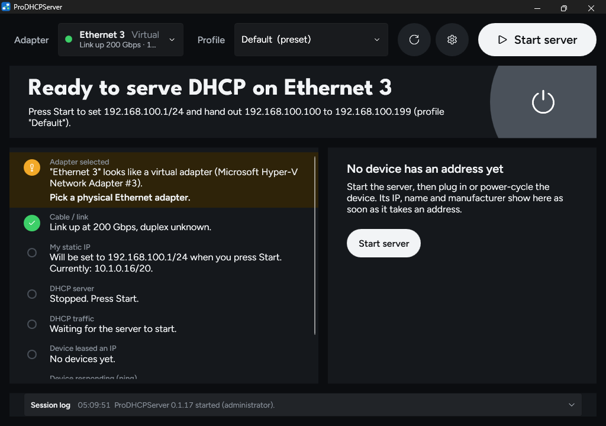

# ProDHCPServer

A portable DHCP server for Windows 10/11, built for AV field technicians.

Plug your laptop into a DSP, camera, switcher, display or control processor, press **Start**, and see within seconds whether the device got an IP address. If it didn't, the app tells you why in plain English and what to try next. When you press **Stop**, your laptop's network settings go back exactly as they were.



> **Status:** Phase 1 (the core DHCP loop) is being built and tested on real hardware. Phases 2 and 3 follow once Phase 1 passes. See [Roadmap](#roadmap).

## Why

Most AV kit ships set to DHCP, and on a bench or a fresh site there's usually nothing to hand out addresses. The usual fixes (a spare router, a command-line DHCP server, guessing static IPs) are slow and leave your laptop's adapter in a mess. ProDHCPServer does the whole job in one window: it sets your adapter up, serves addresses on that adapter only, shows you the device, and puts everything back afterwards.

## Features

**Phase 1 (in progress)**

- **Pick your Ethernet adapter** from a list showing link state, speed and current IP. The app remembers your last choice.
- **Safe adapter changes.** Your adapter's settings are backed up before anything changes and restored on Stop, on exit, at Windows shutdown, and after a crash (offered the next time you open the app).
- **Eight-step status panel**: adapter, cable/link, static IP, DHCP server, DHCP traffic, device leased an IP, device responding to ping, WebUI reachable. Each step is green, amber or red with a plain-English reason and a suggested next step.
- **Won't fight a venue network.** Before serving, it checks for another DHCP server on the cable and refuses to start if it finds one (with a deliberate override for networks you own).
- **Device card** with IP, MAC address, manufacturer (offline lookup, no internet needed), lease time and first-seen time.
- **Open WebUI** in one click, picking http or https from whichever port is open, plus quick port buttons and Copy IP.
- **Several devices at once** behind a small switch, each with its own lease.
- **Wi-Fi and VPN overlap warnings**, with a one-click option to turn Wi-Fi off until you press Stop.
- **Dark and light themes**, with large status text you can read from arm's length.

**Default settings:** server IP `192.168.100.1/24`, addresses `192.168.100.100` to `192.168.100.199`, 60-minute leases. All of these can be changed in **Settings**.

## Download and run

1. Open the [Actions tab](https://github.com/cookingwithsimon/ProDHCPServer/actions/workflows/build.yml), pick the latest green **Build and test** run, and download **ProDHCPServer-win-x64** under Artifacts.
2. Unzip it. You get a single `ProDHCPServer.exe`; there's nothing to install and no .NET runtime needed.
3. Double-click it. Windows asks for administrator rights, because changing adapter settings and serving DHCP require them.
4. The exe isn't code-signed yet, so the first time Windows SmartScreen says "Windows protected your PC". Click **More info**, then **Run anyway**.

## Using it

1. Connect the device to your laptop's Ethernet port (directly or through a small switch) and power it on.
2. Pick your Ethernet adapter at the top of the window.
3. Press **Start**. Steps 1 to 4 go green within a few seconds.
4. Power-cycle the device or replug its cable if it doesn't ask for an address straight away. Its IP, name and manufacturer appear on the right.
5. Click **Open WebUI** to get to the device's web page.
6. Press **Stop** when you're done. Your adapter goes back to how it was.

## Troubleshooting

| What you see | What it usually means |
|---|---|
| Red banner: another DHCP server is on the link | You're plugged into a network that already hands out addresses (office, venue, home router). Unplug from it, or only use **Serve anyway** on a network you own. |
| Step 2 red, "No link" | No cable, a dead port, or the device is off. Steps 2 to 4 recover by themselves when the link comes up. |
| Step 5 amber, no DHCP requests after 30 seconds | The device probably has a static IP or DHCP turned off. |
| The device gets an offer but never accepts it | Some embedded network stacks ignore their own broadcast flag. Tick **Always broadcast replies** in Settings and try again. |
| Step 1 amber, mentions Wi-Fi or VPN | Another adapter is on the same subnet. Use **Turn it off until Stop**, or change the server IP in Settings. |
| The app was killed mid-session | Open it again and click **Restore now** on the banner. The backup lives in `C:\ProgramData\ProDHCPServer\adapter-backup.json` until it's restored. |

If something goes wrong, [open an issue](https://github.com/cookingwithsimon/ProDHCPServer/issues/new/choose) using the **Problem on site** form, and include the session log text if you have it.

## Roadmap

Each phase ends with a hardware test pass on real AV equipment before the next one starts.

- **Phase 1: core loop** (in progress). Everything listed under Features.
- **Phase 2: visibility.** Continuous ping with a latency graph per device, a full session log you can filter and export (TXT/CSV), and saved profiles for subnet, pool, lease time and DHCP options (router, DNS, NTP, option 43/66/150 and custom options).
- **Phase 3: discovery.** Find devices that already have a static IP, move your adapter onto their subnet in one click, and discover devices via mDNS (including Dante), SSDP/UPnP and LLDP/CDP.

## Files it writes

| What | Where |
|---|---|
| Your settings | `%LOCALAPPDATA%\ProDHCPServer\settings.json` |
| Adapter backup (only while a session runs, or after a crash) | `%ProgramData%\ProDHCPServer\adapter-backup.json` |

While serving, the app also adds a Windows Firewall rule so it can receive DHCP traffic (UDP 67 and 68, for this exe only), and removes the rule on Stop.

## For developers

Built with C# on .NET 10 and WPF (Fluent theme), published as one self-contained single-file exe for win-x64.

**Requirements:** the [.NET 10 SDK](https://dotnet.microsoft.com/download/dotnet/10.0). The Core tests and a full build also run on Linux and macOS; running the app needs Windows.

```
dotnet build ProDHCPServer.sln
dotnet test tests/ProDHCPServer.Core.Tests
dotnet publish src/ProDHCPServer.App -c Release -r win-x64 -o publish
```

**Layout**

| Project | What's in it |
|---|---|
| `src/ProDHCPServer.Core` | Platform-independent logic: DHCP packet codec and server engine, adapter backup/restore lifecycle, status rules, manufacturer (OUI) lookup. Fully unit-tested. |
| `src/ProDHCPServer.Windows` | Windows specifics: adapter reading and changes, the UDP 67 socket, ARP entries, firewall rule, other-server probe, ping and port checks. |
| `src/ProDHCPServer.App` | The WPF app: UI, elevation prompt, crash handling. |
| `tests/` | Core unit tests (run anywhere) and Windows integration tests (run on the Windows CI runner and never change adapter settings). |
| `docs/` | Hardware test checklists for each phase. |
| `tools/` | CI smoke test (launches the app and takes screenshots) and the manufacturer list updater (`python3 tools/update-oui.py`). |

**CI.** Every push and pull request runs the **Build and test** workflow on Windows: build, Core and Windows tests, publish the exe, and a smoke test that screenshots the app in light and dark mode. The exe and screenshots are uploaded as run artifacts.

**Contributing.** Work happens on branches with pull requests into `main`. See [CLAUDE.md](CLAUDE.md) for the project rules (they apply to people too), and use the PR template's checklist. Formatting follows `.editorconfig`; check it with `dotnet format whitespace ProDHCPServer.sln --verify-no-changes`.

## Licence

No licence has been chosen yet, so all rights are reserved by the author.
